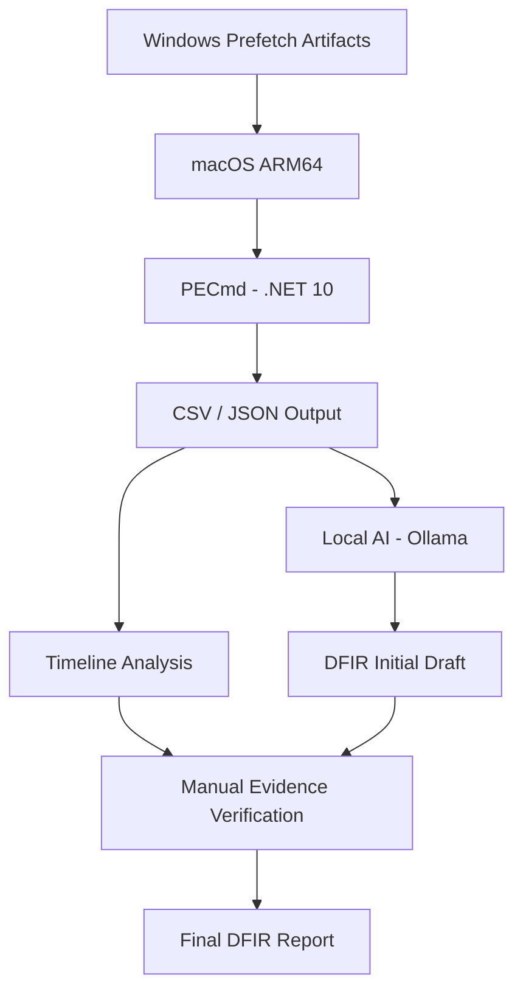

# PECmd Installation Guide on macOS (Apple Silicon ARM64)

## 1. Introduction

PECmd (Prefetch Explorer Command Line) is a digital forensic tool developed by Eric Zimmerman for parsing and analyzing Microsoft Windows Prefetch (`.pf`) files.

PECmd can be used for:

- Digital Forensics and Incident Response (DFIR)
- Windows Execution Artifact Analysis
- Malware Execution Analysis
- Threat Hunting
- Timeline Analysis
- CTF / TryHackMe / Hack The Box Labs

透過 .NET 10 跨平台執行環境，macOS 使用者可以直接執行支援跨平台的 PECmd 版本，不需要額外建立 Windows VM。

## 2. Environment

| Component | Configuration |
|---|---|
| Operating System | macOS |
| Architecture | Apple Silicon ARM64 |
| Shell | Zsh |
| .NET SDK | 10.0.404 |
| PECmd | .NET 10 Edition |
| Developer | Eric Zimmerman |
| Purpose | Windows Prefetch Forensic Analysis |

## 3. Download Resources

- PECmd GitHub: https://github.com/EricZimmerman/PECmd
- Eric Zimmerman Tools: https://ericzimmerman.github.io/
- PECmd Download: https://download.ericzimmermanstools.com/net/PECmd.zip
- Microsoft .NET 10: https://dotnet.microsoft.com/en-us/download/dotnet/10.0

## 4. Install Microsoft .NET 10 SDK

前往 Microsoft .NET 官方網站，下載 macOS ARM64 SDK。

本次使用的安裝套件：

```text
dotnet-sdk-10.0.404-osx-arm64.pkg
```

執行 `.pkg` 安裝套件，完成安裝後開啟 Terminal。

確認 dotnet 指令是否存在：

```bash
which dotnet
```

確認 SDK 版本：

```bash
dotnet --version
```

確認完整環境資訊：

```bash
dotnet --info
```

列出已安裝的 SDK 與 Runtime：

```bash
dotnet --list-sdks
dotnet --list-runtimes
```

> Note: 如果只需要執行 PECmd，原則上安裝對應的 .NET Runtime 即可，不一定需要完整 SDK。本次環境使用 SDK。

## 5. Troubleshooting: dotnet Command Not Found

### 5.1 Problem Description

完成 .NET SDK 安裝後，執行：

```bash
which dotnet
```

沒有顯示任何資訊，或執行 dotnet 時出現：

```text
zsh: command not found: dotnet
```

此情況不一定代表 .NET SDK 安裝失敗，也可能是 PATH 環境變數尚未正確設定。

### 5.2 Verify Installation Directory

確認 .NET 安裝目錄：

```bash
ls -la /usr/local/share/dotnet/
```

使用完整路徑執行：

```bash
/usr/local/share/dotnet/dotnet --info
```

如果可以正常顯示 SDK、Runtime 與 ARM64 架構資訊，代表 .NET 已成功安裝。

### 5.3 Check Environment Variables

確認目前的 PATH：

```bash
echo $PATH
```

確認 Symbolic Link：

```bash
ls -l /usr/local/bin/dotnet
```

確認系統 PATH 設定檔（如果存在）：

```bash
cat /etc/paths.d/dotnet
```

### 5.4 Fix Zsh PATH

將 .NET 安裝目錄加入 Zsh 環境變數。

```bash
echo 'export DOTNET_ROOT=/usr/local/share/dotnet' >> ~/.zshrc

echo 'export PATH="$DOTNET_ROOT:$PATH"' >> ~/.zshrc
```

重新載入 Zsh 設定：

```bash
source ~/.zshrc
```

### 5.5 Verify the Configuration

```bash
which dotnet
dotnet --version
dotnet --info
```

Expected output:

```text
$ which dotnet
/usr/local/share/dotnet/dotnet

$ dotnet --version
10.0.404
```

此時即可正常使用 dotnet 指令。

> 如果已經在 `~/.zshrc` 設定相同的環境變數，不需要重複加入。

## 6. Download and Install PECmd

建立 DFIR 工具目錄：

```bash
mkdir -p ~/Tools/DFIR/PECmd
cd ~/Tools/DFIR/PECmd
```

下載官方 PECmd ZIP 套件：

```bash
curl -fLO https://download.ericzimmermanstools.com/net/PECmd.zip
```

解壓縮：

```bash
unzip PECmd.zip
```

確認檔案：

```bash
ls -la
```

尋找 PECmd.dll：

```bash
find . -name "PECmd.dll"
```

進入包含 `PECmd.dll` 的目錄，執行：

```bash
dotnet PECmd.dll --help
```

如果正常顯示 PECmd Help Menu，即代表工具可以執行。

> 不需要使用 git clone、編譯原始碼、Windows VM、Wine 或 Rosetta 2。

## 7. Configure PECmd Alias

為了避免每次執行 PECmd 都需要輸入完整路徑，可以建立 Zsh Alias。

以下假設 `PECmd.dll` 位於 `~/Tools/DFIR/PECmd/`。

```bash
echo 'alias pecmd="dotnet $HOME/Tools/DFIR/PECmd/PECmd.dll"' >> ~/.zshrc

source ~/.zshrc
```

如果 DLL 位於其他子目錄，請修改為實際路徑。

測試：

```bash
pecmd --help
```

之後即可直接使用 `pecmd` 指令。

## 8. Basic Usage

### 8.1 Parse a Single Prefetch File

```bash
pecmd -f ./sample.pf
```

### 8.2 Parse an Entire Prefetch Directory

```bash
pecmd -d ./Prefetch
```

### 8.3 Export CSV

```bash
mkdir -p ./output/csv

pecmd -d ./Prefetch --csv ./output/csv
```

### 8.4 Export JSON

```bash
mkdir -p ./output/json

pecmd -d ./Prefetch --json ./output/json
```

### 8.5 Export HTML

```bash
mkdir -p ./output/html

pecmd -d ./Prefetch --html ./output/html
```

### 8.6 Display Help

```bash
pecmd --help
```

實際支援的參數以所下載版本的 Help Menu 為準。

## 9. Windows Prefetch Forensic Analysis

Windows Prefetch 預設目錄：

```text
C:\Windows\Prefetch\
```

常見 Prefetch 檔案範例：

```text
CMD.EXE-XXXXXXXX.pf
POWERSHELL.EXE-XXXXXXXX.pf
RUNDLL32.EXE-XXXXXXXX.pf
MSHTA.EXE-XXXXXXXX.pf
CERTUTIL.EXE-XXXXXXXX.pf
```

其中 `XXXXXXXX` 為示意用的 Prefetch Hash。

透過 PECmd 可以解析以下鑑識資訊：

| Artifact | Description |
|---|---|
| Executable Name | 執行檔名稱 |
| Prefetch Hash | Prefetch 識別雜湊 |
| Run Count | 程式執行次數 |
| Last Run Time | 最近執行時間 |
| Previous Run Times | 歷史執行時間 |
| Referenced Files | 關聯檔案 |
| Referenced Directories | 關聯目錄 |
| Volume Information | 磁碟區資訊 |

可應用於：

- 可疑程式執行紀錄分析
- Malware Execution Investigation
- LOLBins Activity Analysis
- Incident Timeline Reconstruction
- Windows Endpoint Forensics

注意事項：

- Prefetch Hash 並非執行檔的 MD5、SHA-1 或 SHA-256。
- Prefetch 中的關聯檔案不代表每個檔案都曾被執行。
- Prefetch 不一定能提供執行者身分與完整命令列。
- 缺少 Prefetch 檔案不代表程式從未執行。
- 鑑識結果應搭配 EVTX、Amcache、ShimCache、MFT、EDR 等其他證據進行交叉驗證。

## 10. Recommended DFIR Workflow



PECmd 輸出的 CSV 或 JSON 可以進一步匯入：

- Timeline Analysis Tools
- Python / Pandas
- SIEM / Graylog
- Ollama / Open WebUI
- Local DFIR Analyzer

AI 分析結果應作為初步分析與報告草稿，不應直接視為已驗證的鑑識結論。

## 11. macOS Compatibility and Limitations

| Feature | macOS ARM64 |
|---|---|
| .NET 10 Native ARM64 | Supported |
| Prefetch Parsing | Supported |
| CSV Export | Supported |
| JSON Export | Supported |
| HTML Export | Supported |
| Volume Shadow Copy Access | Windows Only |
| Alternate Data Streams Features | Windows Only |
| Windows VM Required | No |
| Rosetta 2 Required | No |

PECmd 是 Windows Prefetch 鑑識解析工具，即使在 macOS 執行，也不是用於解析 macOS 本身的程式執行紀錄。

macOS 原生鑑識分析可參考：

- mac_apt: https://github.com/ydkhatri/mac_apt
- APOLLO: https://github.com/mac4n6/APOLLO
- macOS Unified Logs: https://github.com/mandiant/macos-UnifiedLogs

## 12. Forensic Evidence Handling

正式數位鑑識作業中，建議保留原始證據，並使用工作副本進行分析。

計算單一 Prefetch 檔案的 SHA-256：

```bash
shasum -a 256 ./sample.pf
```

批次建立 Prefetch SHA-256 清單：

```bash
find ./Prefetch -type f -name '*.pf' -exec shasum -a 256 {} \; > prefetch_sha256.txt
```

應保留以下資訊：

- Original Evidence
- SHA-256 Hash
- Acquisition Time
- Analysis Time
- Tool Version
- Analysis Commands
- CSV / JSON Results
- Investigator Notes

## 13. Conclusion

PECmd with .NET 10 provides a convenient approach to Windows Prefetch forensic analysis on Apple Silicon macOS.

透過原生 ARM64 .NET 環境，macOS 使用者可以降低對 Windows VM 的依賴，並將 PECmd 整合至個人 DFIR LAB、CTF、Threat Hunting 及地端 AI 分析工作流程。

本篇筆記亦記錄了 .NET SDK 安裝後，因 PATH 未正確設定而無法使用 dotnet 指令的問題與解決方式。

## 14. References

- Eric Zimmerman PECmd
  - https://github.com/EricZimmerman/PECmd
- Eric Zimmerman Tools
  - https://ericzimmerman.github.io/
- Microsoft .NET Download
  - https://dotnet.microsoft.com/en-us/download/dotnet/10.0
- Microsoft .NET Installation on macOS
  - https://learn.microsoft.com/en-us/dotnet/core/install/macos
- MITRE ATT&CK
  - https://attack.mitre.org/

---

**Last Updated:** 2026-11-24

**Platform:** macOS Apple Silicon ARM64

**Category:** Cybersecurity / DFIR / Windows Forensics

**Disclaimer:** This document is intended for educational purposes, authorized security research, digital forensics, and incident response.